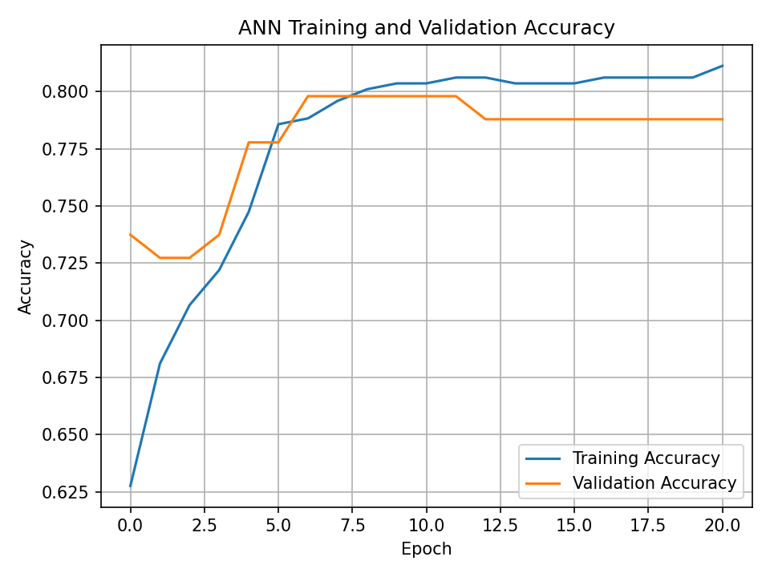
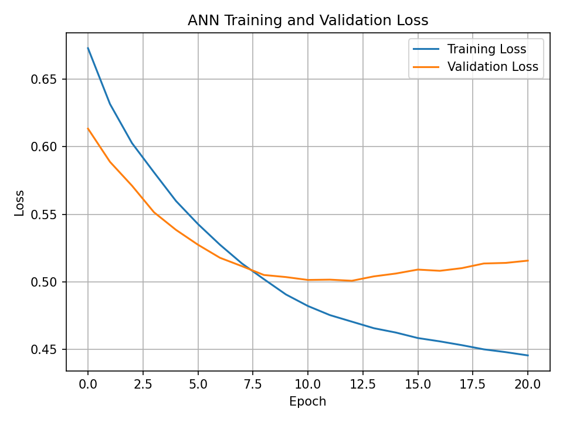

# Loan Approval Prediction Using Artificial Neural Network (ANN)

## Project Overview
This project predicts whether a loan application is likely to be approved or rejected using an Artificial Neural Network (ANN). It uses applicant information such as income, loan amount, credit history, education, and property area to generate a prediction.

The project is developed using Python and Machine Learning techniques, with a web interface built using Flask.

## Abstract
Loan approval is an important process in the banking and financial industry. Evaluating loan applications manually can be time-consuming and may involve complex decision-making. This project uses an Artificial Neural Network (ANN) to analyze applicant information and predict loan approval status. The system includes data preprocessing, model training, and a user interface through which users can enter applicant details and obtain a prediction.

## Objectives
- Predict loan approval status using Artificial Neural Networks.
- Analyze important applicant information.
- Apply machine learning techniques to a financial problem.
- Provide a simple interface for making predictions.
- Understand the model's training and evaluation process.

## Technologies Used
- Python
- Pandas
- NumPy
- Scikit-learn
- TensorFlow / Keras
- Flask
- HTML
- Matplotlib

## Project Features
- Data preprocessing and cleaning
- Missing value handling
- Categorical data encoding
- ANN model training
- Model evaluation
- Training accuracy and loss graphs
- Web-based applicant input form
- Loan approval prediction results

## ANN Model
The project uses an Artificial Neural Network to learn patterns from historical loan application data.

The input features include applicant details such as:
- Gender
- Marital status
- Dependents
- Education
- Self-employment status
- Applicant income
- Co-applicant income
- Loan amount
- Loan term
- Credit history
- Property area

The trained ANN model processes these features and generates a loan approval prediction.

## Methodology
1. Dataset loading
2. Data cleaning and preprocessing
3. Handling missing values
4. Encoding categorical features
5. Splitting the dataset into training and testing data
6. Building the Artificial Neural Network
7. Training the model
8. Evaluating model performance
9. Visualizing training accuracy and loss
10. Predicting loan approval for new applicants

## Application
The project includes a Flask-based web interface where users can enter applicant details and receive a loan approval prediction.

## Project Structure
```text
Loan-Approval-Prediction-ANN/
│
├── app.py
├── train_model.py
├── requirements.txt
├── templates/
│   ├── index.html
│   ├── predict.html
│   └── result.html
│
└── README.md
```

## How to Run the Project

### 1. Clone the repository
```bash
git clone https://github.com/shaikhirfan7k-hue/Loan-Approval-Prediction-ANN.git
```

### 2. Navigate to the project folder
```bash
cd Loan-Approval-Prediction-ANN
```

### 3. Install dependencies
```bash
pip install -r requirements.txt
```

### 4. Add the dataset
Place the required dataset file in the project directory.

### 5. Train the model
```bash
python train_model.py
```

### 6. Run the web application
```bash
python app.py
```

Open the local URL shown in your terminal to use the application.

## Disclaimer
This project is developed for educational purposes only. Predictions generated by the model should not be considered actual financial advice or real banking decisions.

## Author
**Irfan Shaikh**

MSc Information Technology | AI & Machine Learning Projects
## Model Performance

The Artificial Neural Network was evaluated on 123 test applications.

- **Test Accuracy:** 86.18%
- **Correct Predictions:** 106
- **Incorrect Predictions:** 17

### Confusion Matrix

| Actual / Predicted | Not Approved | Approved |
|---|---:|---:|
| Not Approved | 22 | 16 |
| Approved | 1 | 84 |

## Training Results

### Training and Validation Accuracy


### Training and Validation Loss


## Prediction Example

The Flask application successfully generated an **APPROVED** prediction for a sample applicant, with a model output score of **74.83%**.

**Note:** This is an educational prediction model, not an actual lending decision.

## Application Screenshots

### Application Screenshot 1


### Application Screenshot 2


### Application Screenshot 3


